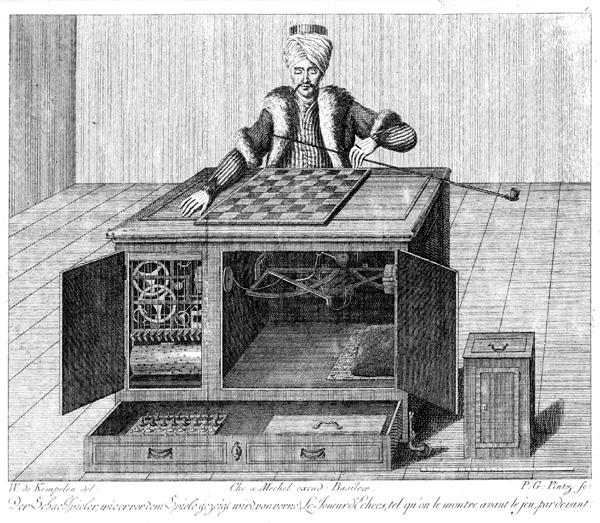

I can't help but think... are we developers becoming the operators of the Mechanical Turk?

Back in 1770, a Hungarian inventor named Wolfgang von Kempelen built the ultimate magic trick: a master chess player that was, itself, a dummy.

And I mean a literal mannequin. A carved figure in a turban, sitting at a wooden cabinet, that pretended to play chess:

Von Kempelen would swing the cabinet doors open for the audience... show them the gears, the clockwork, nothing up his sleeve... then invite someone up to play. And lo and behold, the dummy would win.

Little did they know, the cabinet had a false floor and a sliding seat. A real chess master was folded up inside it, working the arm with levers and magnets from below.

The trick bewildered crowds for decades. It beat Napoleon. It beat Benjamin Franklin. It ran for almost 85 years before the secret fully came out: there was always a human hiding in the box.

It's also where Amazon got the name for its "Mechanical Turk" service... the one where real people quietly do the work software pretends to do. Faked AI, years before AI.

Back then, we tried to dress up NI (natural intelligence) to pass as AI. Now we're trying to do the inverse -- pretty ironic, right?

AWS just announced it's no longer taking new customers for Mechanical Turk, which usually means the lights are eventually going to go off for good. It had its time.

BUT... this brings me back to us.

We used to be the chess player. We wrote every line, moved every piece, knew where every gear was. We were the operator inside the box.

Now? We poke and prod at a little black box that does the work for us. No magnets, no levers... just bits moving around in ways we don't fully understand. We ship it to clients who have no idea how it works.

Hell, 80% of the time, we don't either.

Sounds a bit magical. To them, and to us.

Which sounds all too familiar.

But the more I sit with it, the more it puts me at ease. The Turk's magic was never the operator. It was the illusion of understanding.

Our job was never to know how every gear turns... it was to make the trick land.

The real Turk burned up in a fire in 1854... and maybe one day this box catches fire too.

The difference is, this time, we already know there's a person inside.
